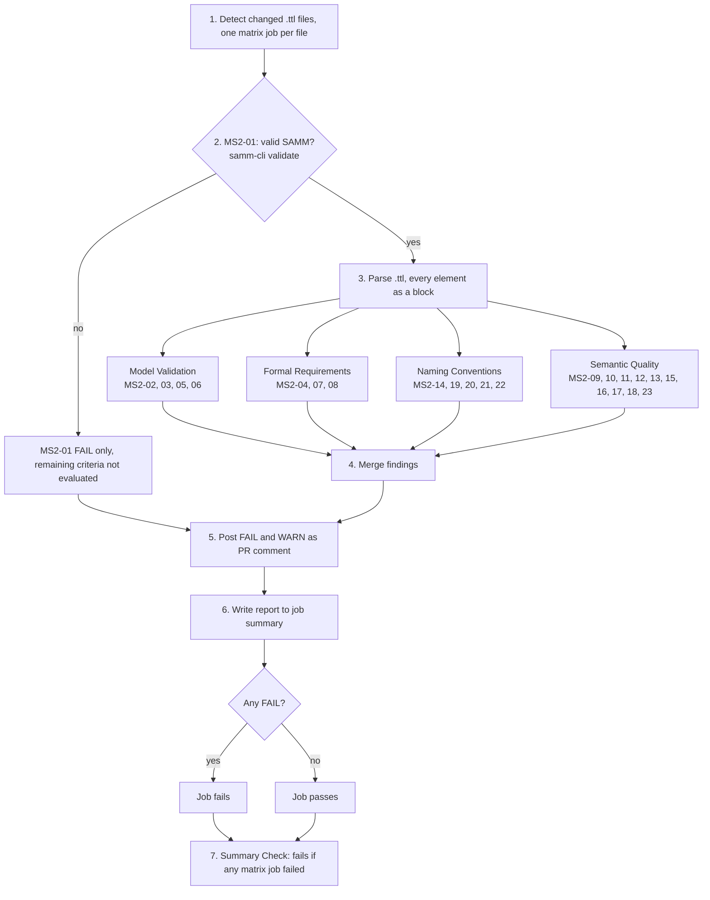

# Automated MS2 Criteria Check

This describes the automated check that runs on every pull request to verify the MS2 checklist items from [`PULL_REQUEST_TEMPLATE.md`](../.github/PULL_REQUEST_TEMPLATE.md) against the changed Aspect Models. It complements, but does not replace, the manual MS2 review described in [`GOVERNANCE.md`](GOVERNANCE.md) - some checklist items are objectively checkable (Camel-Case, semantic versioning, `metadata.json` state, ...), others require human judgement and stay manual (see the "Automation" column in the criteria table below).

## Overview

What happens once the check is triggered by a pull request:



The four categories are independent of each other - none depends on another's result. Each step is detailed in the sections below: the jobs in [CI pipeline](#ci-pipeline-governanceyml), the MS2-01 gate in [The master script](#the-master-script-ms2_checkpy), the categories in [The 23 checklist items](#the-23-checklist-items), and steps 5-6 in [Report format](#report-format) and [PR checklist comments](#pr-checklist-comments-quality_gategithub_commentspy).

## Where everything lives

```text
.github/
├── PULL_REQUEST_TEMPLATE.md          the 23 MS2 checklist items this check implements
├── workflows/
│   └── governance.yml                the CI pipeline (3 jobs, see below)
└── src/
    ├── config.json                   per-repo settings & criterion overrides - lives here,
    │                                 outside model-validation/, so other scripts (e.g.
    │                                 scripts/generate.sh) can share it as their config base too
    └── model-validation/             the MS2 check action
        ├── ms2_check.py              master script / CLI entry point
        ├── requirements.txt          pinned Python dependencies (Dependabot, Dash check)
        └── quality_gate/             the actual package
            ├── config.py                 loads .github/src/config.json
            ├── context.py                shared state handed to every criterion (repo root,
            │                             changed files, lazily-downloaded SAMM CLI jar, plus
            │                             per-model caches for `validate` results and generated
            │                             JSON schema/example payload - see below)
            ├── samm_cli.py                downloads/runs the SAMM CLI jar
            ├── samm_model_parser.py       Turtle parser (no RDF library): every element as
            │                             a block, queried via el.is_a(...) / el.get(...)
            ├── report.py                  Finding type + Markdown table rendering
            ├── github_comments.py         posts/updates one PR checklist comment per
            │                             model, for criteria with POST_COMMENT = True
            │                             (see "Report format" below)
            └── criteria/                  one file per MS2 checklist item
                ├── __init__.py            auto-discovers every cNN_*.py below into REGISTRY
                ├── c01_samm_validate.py
                ├── c02_schema_validates_payload.py
                ├── c03_all_artifacts_generate.py
                ├── ...
                ├── c23_property_characteristic_name_conflict.py
                ├── c24_no_catenax_id_property.py
                └── c25_no_version_overwrite.py
```

## CI pipeline (`governance.yml`)

The pipeline is split into three jobs specifically so that **every changed model gets its own check mark** in the PR UI, while still having one reliable, fixed-name check to mark as *required* in branch protection:

1. **`detect-changed-models`** - the only job that checks out full repository history. Runs `git diff origin/main...HEAD` (three dots: diffs against the merge-base, i.e. what *this branch* changed since it forked from `main`, independent of whatever landed on `main` afterwards) to find every changed `.ttl` file. Outputs them as the `files` job output, which becomes the matrix below. A second diff with `--diff-filter=M` outputs the subset that already existed on `main` (existing versions being overwritten) as `modified`, used by MS2-25.

2. **`ms2-criteria-check`** - a matrix job, one run per entry in `files`. Each run is named `Check MS2 Criteria (<path>)`, so each changed model shows up as its own, separately visible check. Each leg:
   - does a **shallow** checkout (`fetch-depth: 1`) - no repo history needed, since it checks exactly the one file handed in via the matrix and computes no git diff of its own
   - restores/saves the SAMM CLI jar from an `actions/cache` entry keyed on a hash of `config.json` (where the pinned SAMM CLI version lives), so only the first leg per version actually downloads the ~110 MB jar
   - runs `ms2_check.py --file <path> --modified-files <json>` for that one model

   This job is deliberately **not** the one you mark as a required status check: its name (and how many runs of it exist) varies per PR depending on which models changed, and GitHub branch protection can only pin down fixed, known check names.

3. **`ms2-criteria-gate`** - fixed name (`Summary Check`), `if: always()`, waits on the matrix job and fails if any leg failed. This is the one to mark as required in branch protection: it always runs (even with zero changed models, where the matrix is skipped entirely and this job just passes trivially), so it's always selectable and never leaves a required check stuck pending.

## The master script (`ms2_check.py`)

Single CLI entry point, run two different ways by `governance.yml` (see the file's own header comment for the exact flags):

| Mode | Used by | What it does |
| --- | --- | --- |
| `--list-changed-files` | `detect-changed-models` | prints the changed `.ttl` files as JSON, nothing else |
| `--file <path>` | each `ms2-criteria-check` matrix leg | checks exactly one model, no git diff needed |
| `--list-modified-files` | `detect-changed-models` | prints the changed `.ttl` files that already existed on `main` as JSON |
| `--modified-files <json>` | each `ms2-criteria-check` matrix leg | the `--list-modified-files` result, so MS2-25 needs no git history; without it (and with `--file`) MS2-25 reports `SKIP` |
| (no flags) | local/manual runs | auto-detects and checks every changed `.ttl` file via its own `git diff` |

For each file, it: parses the model, loads `config.json`, then hands the parsed model plus a shared `Context` to every enabled criterion in `criteria.REGISTRY`, downgrading `FAIL` to `WARN` for criteria configured as non-blocking, collects all findings, prints them, writes the Markdown report to the job summary, and exits non-zero if anything is still `FAIL`.

**MS2-01 gates every other criterion for a model.** Before running the registry, the master script checks `ctx.validation_result(model)` (`samm-cli aspect <file> validate`) once. If the model doesn't validate, MS2-01 reports its own `FAIL` as usual, but every other criterion is skipped entirely for that model - not run, and not even shown as a `SKIP` row. A model that fails `samm-cli validate` is broken at the most basic level (its Turtle/SAMM structure doesn't hold up), so naming conventions, example values, etc. on top of that are noise, not signal; the report for such a model shows only the single MS2-01 `FAIL` line. This is purely about the *model's* validity - if the SAMM CLI jar itself can't be obtained (see "Running locally" below), that's a different, infrastructure-level failure and is not swallowed into a per-model `SKIP` at all. For a model that does validate, the master script then generates every artifact type (`ctx.generate_artifacts()`, `context.py`) once, into a temp directory, before running the registry - criteria needing generated artifacts (MS2-02, MS2-03) only read that result via `ctx.artifacts(model)`, so no `samm-cli aspect <file> to <format>` runs twice. A file that isn't even syntactically valid Turtle (`samm_model_parser.TurtleSyntaxError`) is handled the same way: a single MS2-01 `FAIL` with the parser's line number, nothing else.

## Criteria (`quality_gate/criteria/`)

Each `cNN_<slug>.py` defines exactly one subclass of `base.Criterion` exposing `ID`, `TITLE`, `CATEGORY`, and `check(model, ctx) -> list[Finding]` - see `base.py` for the blueprint and the validation that runs at import time. `criteria/__init__.py` builds `REGISTRY` by importing every `cNN_*.py` file in numeric order and instantiating the one `base.Criterion` subclass each defines. All 23 currently implement `check` - even a criterion that's a pure judgement call and can't render any verdict (e.g. MS2-10, "abbreviations only when necessary") still has one; it just always returns the same static `SKIP`/`NOTE` Finding regardless of file content, so it still shows up as its own row in the report rather than being invisible.

Optionally, a module can also set `POST_COMMENT = True` (default `False` if omitted) to have its `FAIL`/`WARN` findings included in the per-model PR checklist comment - see "PR checklist comments" below.

**To add or change a criterion:** drop in (or edit) a `cNN_<slug>.py` file with a `base.Criterion` subclass defining `ID`, `TITLE`, `CATEGORY`, and `check`. Nothing else needs to change - no registry to update by hand.

`CATEGORY` is one of `"Model Validation"`, `"Formal Requirements"`, `"Naming Conventions"`, or `"Semantic Quality"` - see the checklist table below for which criterion is in which. It exists purely to group the report table into sections (see "Report format" below); it doesn't affect execution, blocking, or anything else.

The `cNN` file prefix and the `ID = "MS2-NN"` class attribute inside the file are independent: the prefix only controls **execution/report order** (`REGISTRY` is built by sorting on file name), while `ID` is the criterion's actual identity (used in the report, in `config.json` overrides, and everywhere else). They happen to line up for most criteria, but don't have to - e.g. `c03_all_artifacts_generate.py` carries `ID = "MS2-03"` so the artifact-generation check runs right after MS2-01/MS2-02 (all three are checks on whether the model's basic artifacts are even sound), while `c21_camel_case.py` carries `ID = "MS2-21"` and runs near the end.

Each `Finding` has a level:

| Level | Icon in report | Meaning |
| --- | --- | --- |
| `FAIL` | ❌ | objectively violates the MS2 rule, breaks the CI check |
| `WARN` | ⚠️ | heuristic or non-certain violation, doesn't break CI, needs human review |
| `SUCCESS` | ✅ | a genuine automated pass: this was actually checked and nothing is wrong (also synthesized by the master script for a criterion that stays silent when it finds nothing to flag) |
| `NOTE` | ℹ️ | the criterion can never render a pass/fail verdict at all (the question isn't machine-answerable from the file alone) - a fact for the reviewer, not a confirmation of anything. Doesn't break CI (same as `SUCCESS`), but counted separately in the summary line ("N passing" vs "M for manual review") and rendered with a different icon, so it never reads as an actual automated pass |
| `SKIP` | ➖ | couldn't be evaluated (e.g. no Java for the SAMM CLI, disabled via config), or deliberately not attempted because a prerequisite already failed (e.g. MS2-02 when the model doesn't validate) |

### The 23 checklist items

| ID | Category | Automation | Notes |
| --- | --- | --- | --- |
| MS2-01 | Model Validation | ✅ automated | runs `samm-cli aspect <file> validate` for real |
| MS2-02 | Model Validation | ✅ automated | generated JSON schema validates the generated example payload. Schema/payload come from `ctx.artifacts()` (see `context.py`), generated once per model by the master script before any criterion runs |
| MS2-03 | Model Validation | ✅ automated | every artifact type `generate.sh` also produces (AAS XML, AASX, JSON schema, example JSON payload, OpenAPI spec, HTML doc, Parquet) generates successfully - reads the same `ctx.artifacts()` result as MS2-02, so every format is generated only once per model - a model can validate but still fail one specific format (SAMM CLI bug/limitation for that structure) |
| MS2-04 | Formal Requirements | ✅ automated | own `metadata.json` exists with a status in `{release, deprecated, draft, invalidated}`; only `release` is a clean `SUCCESS`, the other three valid states are `WARN` ("please verify this is intentional"), anything else is `FAIL` |
| MS2-05 | Model Validation | ✅ automated | imported/external models are in `release` state |
| MS2-06 | Model Validation | ✅ automated | URN version is valid semver and matches its folder |
| MS2-07 | Formal Requirements | ✅ automated | `RELEASE_NOTES.md` exists and mentions this version |
| MS2-08 | Formal Requirements | ✅ automated (partial) | only checks a copyright header exists; matching it against actual contributors isn't reliably automatable (GitHub usernames vs. company names) |
| MS2-09 | Semantic Quality | ✅ automated | `preferredName`/`description` present, English |
| MS2-10 | Semantic Quality | ⛔ not automated | "abbreviations only when necessary" is a judgement call. Always `SKIP`, no analysis attempted (same pattern as MS2-14) - stays a manual review item on purpose |
| MS2-11 | Semantic Quality | ⚠️ heuristic | redundant property-name prefixes among sibling properties of the same Aspect/Entity - flags (`WARN`), doesn't fail. Groups by `samm:payloadName` when set (falls back to the SAMM identifier), since a payload-name override can already resolve the redundancy even if the underlying SAMM identifiers still share a prefix |
| MS2-12 | Semantic Quality | ✅ automated | `preferredName` != `description` |
| MS2-13 | Semantic Quality | ⚠️ heuristic | `preferredName` looks Camel-Case (`WARN`, not `FAIL`) - a lowercase-to-uppercase hump can't be told apart from a genuine single term with internal capitalization (e.g. "eCommerce"), so this is a plausible but not certain violation |
| MS2-14 | Naming Conventions | ⛔ not automated | plural aspect name required for a single Collection-valued property. Always `SKIP`, no analysis attempted (same pattern as MS2-10): English singular/plural has too many edge cases (irregular plurals not ending in "s") |
| MS2-15 | Semantic Quality | ⚠️ heuristic | units should come from the SAMM catalog. Flagged cases are `SKIP`, never `WARN`: a non-catalog unit prefix or a custom `samm:Unit` definition is only a fact the script can point at, not evidence of a violation - it has no way to know whether a matching catalog unit actually exists for that quantity. The "nothing to flag" case is `NOTE` rather than `SUCCESS`, for the same reason: it still can't confirm the *right* catalog unit was actually chosen |
| MS2-16 | Semantic Quality | ℹ️ informational (`NOTE`) | constraints usage - always the same static "checked by reviewer" note plus what's actually defined; whether more constraints are *needed* can't be judged from the file at all |
| MS2-17 | Semantic Quality | ℹ️ informational (`NOTE`) | `samm:see` usage - same reasoning and treatment as MS2-16 |
| MS2-18 | Semantic Quality | ✅ automated | simple-typed properties have an example value |
| MS2-19 | Naming Conventions | ✅ automated | non-property identifiers start uppercase |
| MS2-20 | Naming Conventions | ✅ automated | no `__` in identifiers/payload names |
| MS2-21 | Naming Conventions | ✅ automated | Camel-Case identifiers |
| MS2-22 | Naming Conventions | ✅ automated | property identifiers start lowercase |
| MS2-23 | Semantic Quality | ✅ automated | property and its Characteristic don't share a name |
| MS2-24 | Naming Conventions | ✅ automated | property identifier / `payloadName` is not `catenaXId` in any spelling (compared case-insensitively, ignoring non-alphanumeric characters) |
| MS2-25 | Model Validation | ✅ automated | an existing model version (`.ttl` that already exists on `main`) must not be modified - every change needs a new version folder. Hard `FAIL` |

## Config (`.github/src/config.json`)

Two sections, both optional - a missing or empty file behaves exactly like default settings for everything:

```json
{
  "settings": {
    "samm_cli_version": "2.16.0",
    "samm_cli_sha256": "f3f0900e9c9001d4dc97c5b04534dcb02ba2c0c3991339e4830d3d8b014efdcd"
  },
  "criteria": {
    "MS2-09": { "blocking": false },
    "MS2-20": { "enabled": false }
  }
}
```

- **`settings.samm_cli_version`** - the SAMM CLI version to download and run (MS2-01/MS2-02/MS2-03). Single source of truth; deliberately *not* parsed out of `README.md` prose, so it can't silently drift and doesn't invalidate the SAMM CLI cache on unrelated README edits.
- **`settings.samm_cli_sha256`** - SHA-256 of the `samm-cli-<version>.jar` release asset. Required whenever `samm_cli_version` is set; a downloaded or cached jar with a different hash aborts the run (also in `scripts/generate.sh`). When bumping the version, take the hash from the asset's `digest` on the GitHub release (or `shasum -a 256` of the downloaded jar).
- **`criteria.<ID>.enabled`** (default `true`) - set to `false` to skip a criterion entirely (shows as `SKIP`/➖, no further detail).
- **`criteria.<ID>.blocking`** (default `true`) - set to `false` to keep a criterion running and reporting, but downgrade any `FAIL` it produces to `WARN` so it no longer breaks the `ms2-criteria-gate` check. Still a MUST per the PR template, just not (yet) enforced automatically.

A criterion ID in the config that doesn't match any known criterion prints a `WARNING:` line in the job log (typo protection) but doesn't fail the run.

## Report format

Written to the GitHub Actions job summary (and printed to the console). Since each CI matrix leg checks exactly one model, its report title carries the model's file path directly (`# MS2 Criteria Report — <file>`) instead of a redundant per-model sub-header; a local run checking several changed `.ttl` files at once (no `--file`) keeps a generic title with a `## MS2 Criteria — <file>` sub-header per model instead, so the sections stay distinguishable.

Within a model's section, criteria are grouped into their `CATEGORY` (`Model Validation` / `Formal Requirements` / `Naming Conventions` / `Semantic Quality` - see the checklist table above), each its own sub-header (`##`, or `###` when nested under a per-model sub-header in the multi-file case), ordered by the lowest criterion ID it contains. Each category's table has one row per criterion: status icon, criterion ID, criterion name, and message. A criterion that produces multiple findings for the same model shows the worst icon and all messages (`<br>`-joined) in one row. Messages are wrapped in an inline code span for monospace rendering, since real line breaks aren't possible inside a Markdown table cell - collapsible `<details>` sections were tried for long multi-line output (e.g. a full samm-cli error dump) but GitHub's job-summary sanitizer strips that tag entirely, so plain inline code is what's left.

The summary line above each model's table (`**Summary:** N failing, M warnings, X passing, Y for manual review, Z skipped.`) counts `SUCCESS` and `NOTE` separately: `X passing` is genuinely `SUCCESS` only, `Y for manual review` is `NOTE` only - they're kept apart on purpose so "passing" always means "an automated check actually ran and found nothing wrong", not diluted by criteria that can't render a verdict at all (MS2-16, MS2-17, and MS2-15 when it has nothing to flag). MS2-10 and MS2-14 can't render a verdict either, but report `SKIP` and are therefore counted under `Z skipped`, not under `Y for manual review`.

## PR checklist comments (`quality_gate/github_comments.py`)

In addition to the job-summary report above, criteria with `POST_COMMENT = True` also get their `FAIL`/`WARN` findings collected (per model, across all such criteria) and posted as **one PR comment per model** - a Markdown checklist, e.g.:

```markdown
### MS2 Criteria issues — `io.catenax.pcf/10.0.0/Pcf.ttl`

- [ ] ⚠️ **MS2-12** (io.catenax.pcf/10.0.0/Pcf.ttl:148) — preferredName 'FooBar' looks Camel-Case
```

This is a plain PR **issue** comment (`POST`/`PATCH .../issues/{pr}/comments`), not a diff-anchored **review** comment. An earlier version used review comments instead, but GitHub's review-comment API only accepts lines that are part of the PR's diff - a `FAIL` on an untouched, pre-existing line would then silently fail to post. Issue comments have no such constraint and are simpler to keep in sync besides: since there's at most one comment per model, a re-run just `PATCH`es it in place (matched via a hidden `<!-- ms2-check:<path> -->` marker in the body) instead of tracking "does a comment for this exact finding already exist".

Needs `pull-requests: write` on the `ms2-criteria-check` job in `governance.yml` (least-privilege: only that job gets it) and `GITHUB_TOKEN` passed to the "Run MS2 criteria check" step's `env`. Silently does nothing (just a log line) when posting isn't possible or doesn't apply - no `pull_request` event, no token, or no findings for that model - never a reason to fail the check itself.

Known limitations of this first version:

- The checklist body is fully regenerated and `PATCH`ed on every run - checkboxes always start at `- [ ]`, so ticking one off manually doesn't survive the next update.
- If every finding for a model gets fixed, the comment is left exactly as it was (not deleted, not marked resolved) rather than being cleared - a `[]` findings list is a no-op, on purpose, since GitHub gives no cheap way to distinguish "nothing to report" from "haven't checked yet".
- If a human hides ("minimizes") the comment, later updates don't un-hide it - GitHub's `unminimizeComment` GraphQL mutation (REST has no equivalent) reliably fails for the Actions-provided `GITHUB_TOKEN` ("Resource not accessible by integration", a known GitHub limitation) - fixing this for real would need a PAT stored as a repo secret, not currently considered worth it. Whether something is still actually open is always visible from the check run status itself regardless.

## Running locally

```bash
# check every .ttl file changed on this branch vs. origin/main
python .github/src/model-validation/ms2_check.py

# check one specific file
python .github/src/model-validation/ms2_check.py --file io.catenax.batch/4.0.0/Batch.ttl
```

Run from the repository root. MS2-01/MS2-02/MS2-03 need Java on `PATH` to run the SAMM CLI; without it they report `SKIP` rather than failing the whole run. MS2-02's JSON-schema-vs-payload cross-validation additionally needs the `jsonschema` Python package (versions as pinned in `.github/src/model-validation/requirements.txt`; that file only carries hashes for the CI platform, Linux x86_64 / Python 3.13, and is kept up to date by Dependabot) - without it, schema and payload still get generated, just not cross-validated.

That graceful `SKIP` only covers Java itself being absent - a legitimate, expected state for a local machine. If Java *is* present but the SAMM CLI jar still can't be downloaded (`samm_cli.py`'s `ensure_samm_cli`), that's left to raise and crash the run instead of being swallowed into a `SKIP`. In CI, Java is guaranteed via `actions/setup-java` (see `governance.yml`), so a download failure there means the CI environment itself is broken (e.g. GitHub releases unreachable) - a genuine job failure that needs a re-trigger, not a model-related `SKIP` buried in the report.
